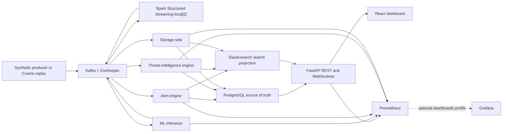

# Current architecture

The default Compose project is a single-node development and measurement stack. Its
source is synthetic unless the Cowrie adapter is invoked explicitly. CIC-IDS-2017 is
used only by the offline evaluator.

## Event path

1. The producer publishes login, API, network, or anomaly records to Kafka. Kafka is
   single-broker and uses ZooKeeper; this is not a high-availability deployment.
2. Spark runs in one `local[2]` container. It normalizes each event and publishes
   enriched records immediately, while feature and window records use a one-minute
   event-time window, a 30-second slide, and a two-minute watermark.
3. ML inference consumes the 18-field feature contract and publishes predictions.
   The alert engine also consumes enriched records directly, so some rules do not
   wait for a window to close.
4. The alert engine persists cooldown state, alerts, incidents, links, and its search
   outbox transactionally in PostgreSQL. The threat-intelligence engine evaluates the
   four enabled YAML rules and demonstration IOC feeds.
5. The storage sink batches receipt claims, business rows, and Elasticsearch outbox
   work in one PostgreSQL transaction, then commits Kafka offsets. PostgreSQL remains
   authoritative; Elasticsearch is an asynchronous, retryable search projection.
6. FastAPI reads PostgreSQL and Elasticsearch and serves the authenticated React UI.

The windowed path deliberately waits for event-time closure. A one-minute window plus
the two-minute watermark can therefore take minutes even without backlog; the measured
high-rate results in `benchmarks/results/latest.md` include additional queueing.

## Default services

The root Compose file has 13 long-running services: ZooKeeper, Kafka, PostgreSQL,
Elasticsearch, backend, frontend, producer, Spark, ML inference, storage sink, alert
engine, threat-intelligence engine, and Prometheus. `kafka-init` and
`schema-bootstrap` are one-shot setup services. Grafana is available only through the
`dashboards` profile.

The hardened Compose project is separate and experimental. It retains a secured
Spark master/worker design, is not exercised by the three GitHub Actions workflows,
and should not be inferred to have the default stack's benchmark results.
